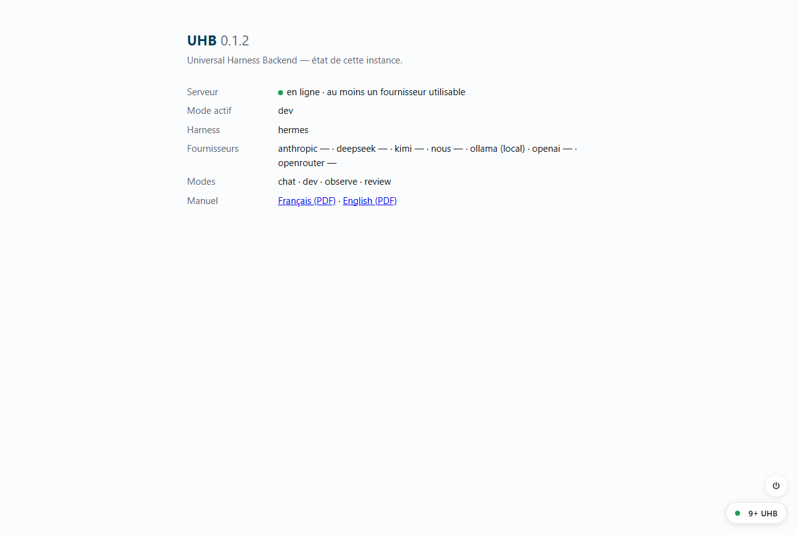
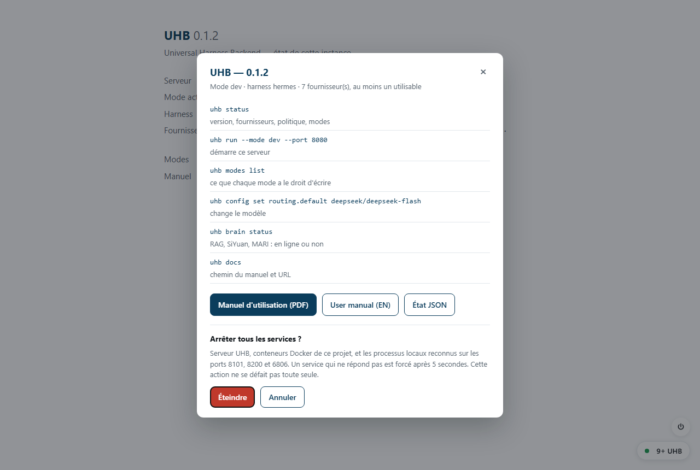
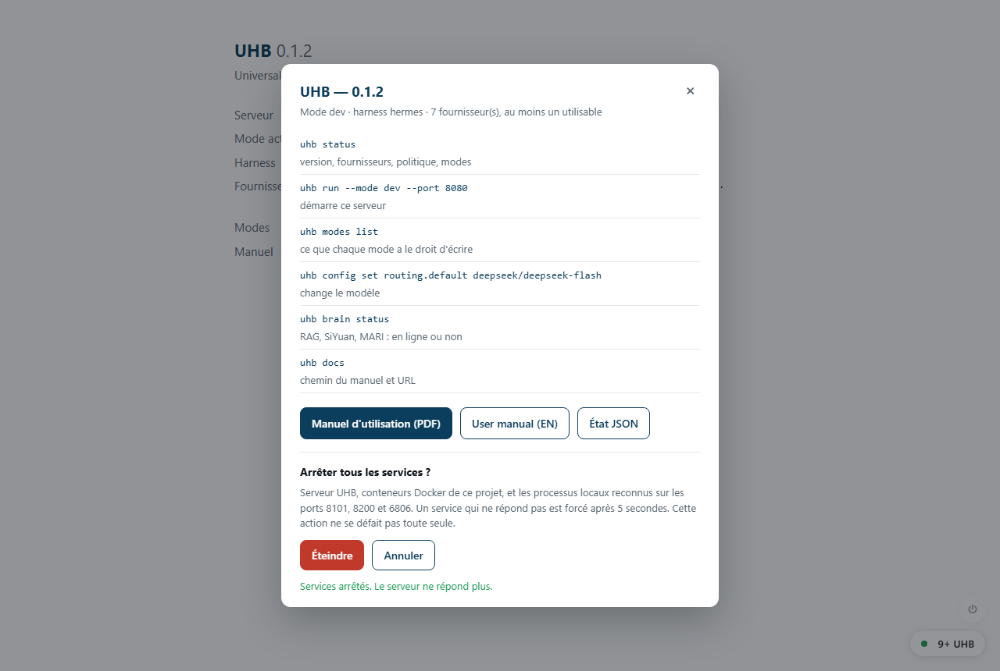

# The power button — proof it stops the stack and leaves no ghost

The gap this closes: after every manual test, a container or a keep-alive process
still held 8101, 8200 or 6806, and the next start failed with *address already in
use*. One button, one route, and an answer that names what is left.

## What the button is

`POST /shutdown`, plus a power icon rendered above the `9+ UHB` badge. It is part
of the widget, so it appears on the panel at `/` and — only if the integrator asks
(`uhb ui --markup --shutdown`) — in a pasted dashboard.



Clicking it opens the confirmation, which says what will stop and what happens to
a service that does not answer:



Confirmation sends `{"confirm": true}` and the token; nothing is stopped on a
single click, and nothing is stopped without the token.

## Three gates, and none is optional

| Gate | Refusal |
| --- | --- |
| token, `X-UHB-Token` (`$UHB_SHUTDOWN_TOKEN` or `~/.uhb/shutdown-token`) | `401` |
| `{"confirm": true}` — exactly `true`, not `"yes"` | `403` |
| `stop` in a closed set (`docker`, `local`, `self`) | `400` |

The token is what stops a stray page or script from killing the stack. It is a
local secret, not a boundary against a hostile local user, who can read the file.

## The plan first

`dry_run` answers with what *would* stop, and touches nothing. Real output from a
live server on 8106, token read from the file (never printed):

```
HTTP 200
{
  "dry_run": true,
  "targets": ["docker", "local", "self"],
  "docker": {"containers": [], "action": "nothing to stop"},
  "local": [
    {"port": 8200, "pid": 21028, "name": "python.exe", "ours": true},
    {"port": 6806, "pid": 3296, "name": "SiYuan-Kernel.exe", "ours": true}
  ],
  "refused": [],
  "self": "stopped after the response",
  "notes": []
}
```

Two real listeners were found and recognised as ours: the RAG service on 8200 and
the SiYuan kernel on 6806. A browser or a database on those ports would have landed
in `refused` with the reason, and would never be killed.

## The local branch, on a real process

The only safe live proof of a kill is a process this test started on a port it
chose. `python -m http.server` on a free port, then `stop_local(ports=(that,))`:

```
1. enfant demarre : pid=11076 · port=58254 · ecoute=True · vivant=True
2. decouvert par UHB : [{'port': 58254, 'pid': 3280, 'name': 'python.exe', 'ours': True}]
3. local · ok=True · python.exe (pid 3280) on port 58254: killed after the grace period
4. apres arret : ecoute=False · code du pid=1
OK — port libre, aucun fantome
```

Worth reading twice: the *polite* `taskkill /PID … /T` did **not** stop it — a
console process with no window ignores the close request — so the 5 s grace
expired and the kill followed. That is the branch that would have left a ghost
without the fallback. Nothing else on the machine was touched: the port list was
exactly `(58254,)`.

Two defects were found by this live run and are now pinned by tests:

- `tasklist` and `netstat` answer in **cp850** on a French Windows; decoding them
  as UTF-8 killed the reader thread and the branch crashed instead of stopping the
  process (`test_console_output_that_is_not_utf8_is_decoded_not_crashed`);
- the widget's CORS preflight advertised `GET` only, so a dashboard on another
  loopback port was blocked by the browser before it could POST: the button
  reported a network failure on a perfectly healthy server
  (`test_the_preflight_allows_the_token_header_for_a_loopback_dashboard`).

## The whole button, clicked

Same page, one injected click on the real handler, `data-uhb-stop="self"` so the
demo could only stop the server it targets:



```
$ curl -s -m 3 -w "apres_arret=%{http_code}\n" http://127.0.0.1:8105/status -o after.json
apres_arret=000                     # connection refused: the server is gone
$ netstat -ano | grep LISTENING | grep :8105
(rien)
```

The panel reads "Services arrêtés. Le serveur ne répond plus." in green, the
listener is gone, and the `uhb run` process exited on its own: `serve()` returns
after `server.shutdown()`, so there is no orphan and no port left behind.

## What the demo did not do, and why

`data-uhb-stop` scoped it to `self`. The panel's own button sends no scope, so it
stops all three targets — which on the reference machine means the operator's RAG
(8200) and SiYuan (6806) as well. That is the feature as asked for ("tout
éteindre"), and the confirmation says it in those words; the dry run above is the
proof that it is visible before it happens.

## What this does not prove

- A Docker stop, end to end: the stack was down while this was written. The
  command is `docker compose down --timeout 10`, its argv and its verification are
  pinned by tests, and the compose proof (`docker-compose-e2e.md`) exercises the
  same project.
- A graceful stop of SiYuan through its own UI: the kernel is signalled like any
  other console process.
- POSIX signals: the tests inject the runner, so `kill`/`killpg` are exercised by
  reading, not by running, on this machine.
