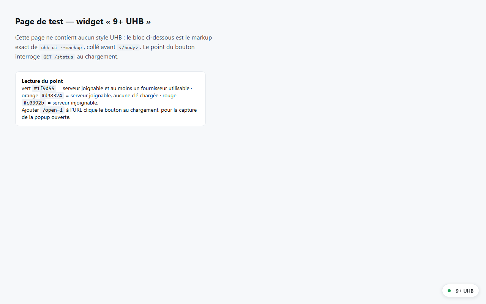
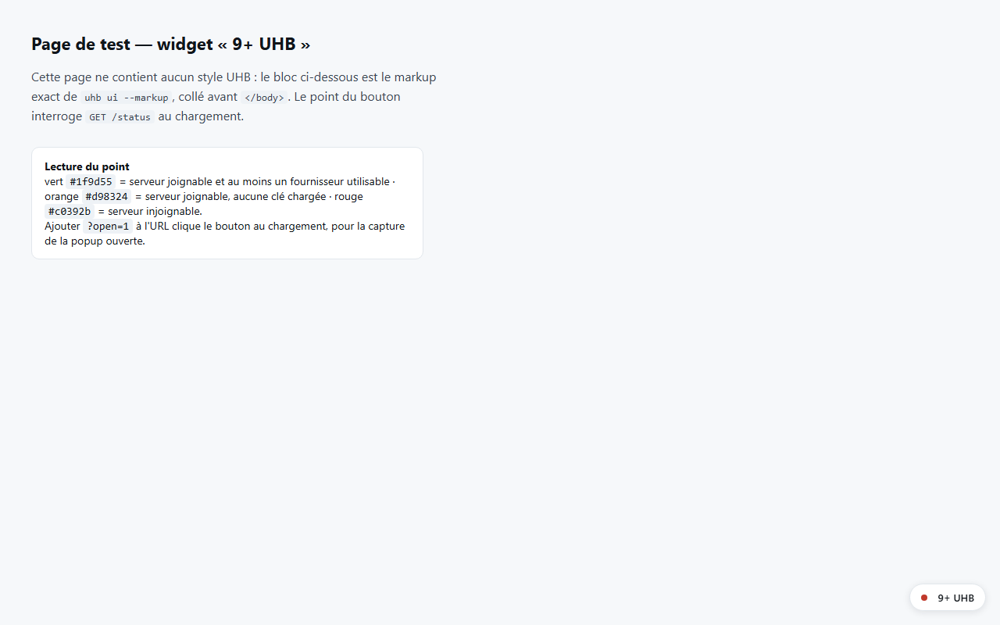
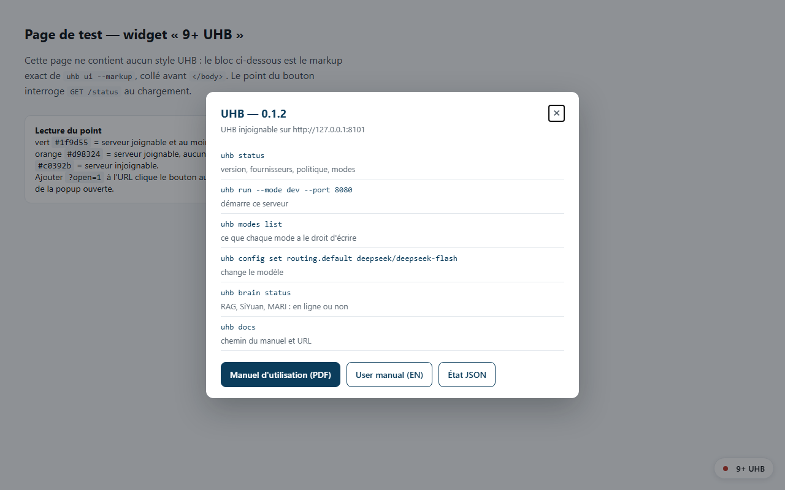

# The "9+ UHB" widget — proof in a real page

A real HTML page, the real markup, a real Chrome, and a real server that is
started then stopped. Nothing here is a mock: the page is served from
`file://`, so the widget's `fetch` is cross-origin into `http://127.0.0.1:8101`
— the exact situation `uhb ui --markup` is pasted into on a dashboard.

## What the page is

`test_ui.html` at the repository root. It carries the markup of
`uhb ui --markup` verbatim, plus a host-page style block that deliberately uses
its own fonts and colours: if the widget leaked a rule, this page would show it.

The file is generated, not hand-copied, so it cannot drift from the code:

```console
$ python tools/make_test_ui.py --check
test_ui.html matches uhb ui --markup
```

The dot, from `uhb/entrypoints/panel.py` (`WIDGET_CSS`):

| Class | Colour | Meaning |
| --- | --- | --- |
| `.uhb-dot.uhb-ok` | `#1f9d55` | server reachable, at least one provider usable |
| `.uhb-dot.uhb-warn` | `#d98324` | server reachable, no key loaded and nothing local |
| `.uhb-dot.uhb-bad` | `#c0392b` | server unreachable |

## How it was run

```console
$ uhb run --port 8101          # terminal 1
$ chrome --headless=new --window-size=1280,800 --virtual-time-budget=6000 \
      --screenshot=01-badge-closed-green.png \
      file:///<checkout>/test_ui.html
```

`<checkout>` is this repository's absolute path, elided throughout: the
repository forbids machine paths in prose, and every value below is otherwise
verbatim.

`?open=1` appends one script that calls `document.getElementById("uhb-badge").click()`
— the widget's own handler — so the open state is produced by the code, not by
editing the DOM.

## 1. Server up




What the DOM says once the page has run (`chrome --dump-dom …?open=1`):

```
class="uhb-dot uhb-ok"
id="uhb-modal" role="dialog" aria-modal="true" aria-labelledby="uhb-title"
UHB — 0.1.2
Mode chat · harness hermes · 7 fournisseur(s), au moins un utilisable
```

`class="uhb-dot uhb-ok"` is written by `paint()` after the `fetch` resolved;
`#uhb-modal` has no `hidden` attribute any more, which is what "open" means in
this widget.

Pixel check (`tools/check_badge_shots.py` reads the PNG, it does not trust a
coordinate):

```console
$ python tools/check_badge_shots.py docs/proof/01-badge-closed-green.png --expect ok
01-badge-closed-green.png    dot=ok   distance=0.0   runner-up=120.5  at=(1180, 762) [ok]

$ python tools/check_badge_shots.py docs/proof/02-badge-open-green.png --expect ok --dimmed
02-badge-open-green.png      dot=ok   distance=54.2  runner-up=120.7  at=(1179, 763) [ok] (dimmed by the open popup)
```

`distance=0.0` is the exact CSS value `#1f9d55` found at `(1180, 762)` — 6×6
pixels of the 8 px dot, the rest being antialiasing. In the open shot the modal
backdrop covers the badge, so the same green arrives dimmed (54.2 from its CSS
value, 120 away from the nearest other palette colour); `--dimmed` says so
instead of pretending the pixel is pristine.

## 2. Server stopped

`uhb run` interrupted with Ctrl+C, `curl http://127.0.0.1:8101/status` → exit 7
(connection refused), then the same two screenshots:





```
class="uhb-dot uhb-bad"
UHB injoignable sur http://127.0.0.1:8101
```

```console
$ python tools/check_badge_shots.py docs/proof/03-badge-closed-red.png --expect bad
03-badge-closed-red.png      dot=bad  distance=0.0   runner-up=62.4   at=(1180, 762) [ok]

$ python tools/check_badge_shots.py docs/proof/04-badge-open-red.png --expect bad --dimmed
04-badge-open-red.png        dot=bad  distance=74.5  runner-up=87.7   at=(1179, 763) [ok] (dimmed by the open popup)
```

The checker is fail-closed: crossing the expectation fails.

```console
$ python tools/check_badge_shots.py docs/proof/03-badge-closed-red.png --expect ok
03-badge-closed-red.png      dot=bad  distance=0.0   runner-up=62.4   at=(1180, 762) [ok]  expected ok
exit=1
```

## 3. The popup's memory routes, as the page sees them

Same page, same server, two different environments — the routes fail closed
with a reason instead of an empty list:

```console
$ curl -s "http://127.0.0.1:8102/siyuan/blocks"          # no SIYUAN_TOKEN
{"error": {"message": "SiYuan is not configured: set SIYUAN_TOKEN (and SIYUAN_URL) before asking for blocks", "type": "memory"}}
http=400

$ curl -s "http://127.0.0.1:8101/siyuan/blocks"          # token set, kernel not running
{"error": {"message": "SiYuan is not reachable at http://127.0.0.1:6806 (ConnectError)", "type": "memory"}}
http=502

$ curl -s http://127.0.0.1:8101/rag/status               # RAG service not running
{"built": false, "source": "disk", "last_indexed": null, "documents": null,
 "chunks": null, "index_bytes": 0, "service": false,
 "service_url": "http://127.0.0.1:8200",
 "path": "C:\\Users\\searc\\UHB-Universal-Harness-Backend\\uhb\\services\\rag"}
```

## What this does not prove

- A third-party dashboard with its own CSS framework: `test_ui.html` is a clean
  page, so it proves the widget's rules are scoped, not that they survive a
  hostile host stylesheet.
- Browsers other than Chrome 157.0.8103.79 (headless). The widget uses no API
  beyond `fetch`, `dataset` and `classList`.
- The panel at `/` — that page has its own status table and is covered by
  `uhb/tests/test_entrypoints.py`.
